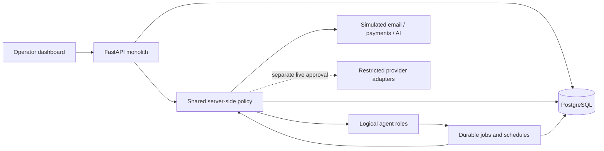

# Jarvis Lite v1 architecture

Jarvis Lite is a separate application under `apps/jarvis-lite`, based on the
working `fix/data-safe-migrations-render-blueprint` branch. The existing Go,
Next.js, AI Engine, MCP, full-stack Compose and `render.yaml` deployment remain
available; Lite does not require them to run.

The product is an internal business-operator console. It is not a hosted
multi-tenant workspace product. The existing Ignitic license and visible
Ignitic attribution are retained. Offering customer workspaces on this deployment
would need a separate license review; customers of the first service receive
an agreed delivery, not console access.

## Small deployment footprint

One Python web process serves the dashboard, authenticated REST API, policy
checks and background worker. One private PostgreSQL database retains records,
jobs, leases, reservations, audit entries, suppressions and provider events.
There is no mandatory RabbitMQ, MongoDB, Redis, Neo4j, MCP server, separate Node
build or paid scheduler. A single worker checks due schedules while the web
process runs. Render restarts that process after a crash; durable job state
remains in PostgreSQL.

SQLite is an explicitly local/demo alternative for convenient development. A
production configuration requires PostgreSQL. Neither the app container's
filesystem nor an in-memory queue is treated as production persistence.

The HTTP interface and provider adapters use familiar FastAPI, HTTPX and
cryptography components already present in Ignitic. A separate, small locked
dependency set avoids installing the original AI Engine's graph/vector stack.
Agent roles are logical functions with bounded execution, not separate services
or six unconstrained model loops.

## Central controls

* CEO prioritizes persisted work and reports status; it cannot approve payments,
  change prices or bypass a stop condition.
* Lead Research records source and collection time, deduplicates leads and
  captures relevant evidence from approved inputs. Untrusted text is evidence,
  never a tool-permission instruction.
* Sales prepares a standard offer using the approved service registry and
  deterministic price/discount rules. A model cannot rewrite those rules.
* Delivery runs the approved incoming-enquiry assistant in a test environment,
  classifies messages, prepares responses and produces a delivery report. A
  missing customer integration or permission produces a manual task, not a
  fictitious production installation.
* Finance creates a payment draft, then waits for explicit administrator
  approval. Only verified provider evidence can confirm a payment. A customer
  payment is separate from a bank payout.
* Compliance evaluates the approved channel, recipient type, legal-review
  evidence, suppression list and rate limits. It can halt other roles.

All roles use the same central guard immediately before provider actions. Demo
is the default and live execution additionally requires the runtime capability,
administrator approval and action-specific prerequisites. Adding a model tool
does not add permission. Provider keys are encrypted at rest, omitted from
dashboard payloads and excluded from audit details.

The global kill switch blocks new paid AI operations, sends, payment requests
and external writes. It preserves received events and history. Safety epochs
and paused jobs prevent turning the switch off from silently resuming work.
An administrator must explicitly review and resume affected jobs. The switch
cannot retract a request already accepted by an external provider.

## Durable execution and accounting

Database transactions serialize policy/budget decisions so concurrent jobs
cannot reserve the same available balance independently. Job claims and leases
are persisted before execution. An idempotency key identifies the intended
operation; replaying the same key with a changed payload is rejected. Provider
idempotency keys and unique event identifiers prevent duplicate requests and
duplicate webhook accounting.

Potentially charged actions reserve the estimated cost before executing.
Settlement records actual usage and releases only the unused balance. An
uncertain provider outcome retains its reservation for review; it must not be
blindly retried or declared free. Actual overruns are recorded honestly and
block new work rather than hiding the expense.

External input cannot directly assign arbitrary state-machine states or mark
payments paid. Every supported transition checks prerequisites and appends an
audit entry. Inbound provider events require signature, freshness and replay
checks. Payment confirmation also checks the expected customer/reference,
currency and amount. Card data is never stored.

## Demonstration and live boundaries

The simulated customer journey covers research, qualification, compliance,
approved test contact, reply, standard offer, acceptance and test delivery. It
pauses at `PAYMENT_APPROVAL_REQUIRED`. That pause is intentional: full autonomy
must not erase the mandatory human payment gate. After an administrator approves
the simulated request, the test provider can confirm a correctly signed demo
payment and the workflow can complete.

No live mode is enabled by installation, seed data, CI or Docker startup. No
production customer system is modified. Real research sources, email sending,
LLM inference, payments and delivery integrations require credentials and a
separate reviewed activation. See the deployment guide for the operational and
legal gates; simulation success is not proof of deliverability or legal
permission to contact a recipient.

In this release a successful local delivery test is `TEST_VERIFIED`, not proof
of a customer production installation. A live workflow retains
`DELIVERY_IN_PROGRESS`, records `production_installed=false` and creates a
manual task. It cannot advance to the production delivery/payment gate without
actual authorized customer verification, which this release does not perform.
An earlier demo delivery cannot authorize a payment merely because mode changes.
Financial totals also keep simulated and live provider receipts separate rather
than turning a mode switch into real revenue.
