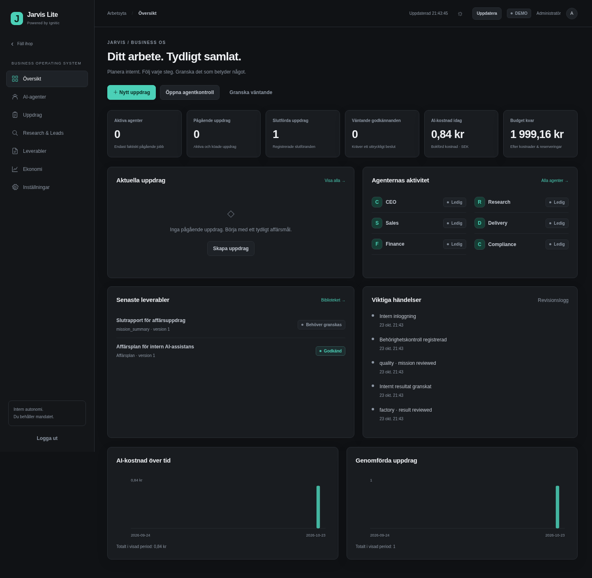
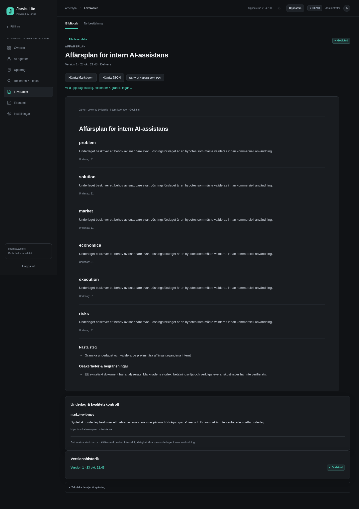

# Jarvis Lite v1.3 · implementation, review and operating guide

v1.3 builds on production branch `feat/jarvis-lite-v1` at merge commit
`33b41e7c`, which contains the reviewed v1.2 implementation. Changes are developed
on `feat/jarvis-lite-v1.3`; they do not merge or deploy themselves. The existing
FastAPI application, vanilla JavaScript frontend, PostgreSQL record store and
in-process durable worker remain the architecture. No additional broker,
microservice, database or paid infrastructure is required.

The production address supplied for this task is
`https://jarvis-lite-c174.onrender.com`. Read-only health/static requests from the
development environment returned HTTP 403. The repository base was inspected,
but current production health, deployed image, environment values, provider
account and raw failed response could not be independently inspected. No Render
settings, production records, credentials or billing configuration were changed.

## Structured response repair

The v1.2 adapter parsed a model response directly as JSON, then required exactly
the outer keys `action`, `text` and `reason`, with string `text`. Harmless fenced
JSON, an object in `text`, or a direct valid role payload could therefore trigger
the observed `The structured response failed the action/shape policy.` message.
The error supplied in the task does not identify which actual production payload
caused it. Regression fixtures reproduce the strict-format failure without
claiming access to that private payload.

Known internal role contracts now describe bounded plan, research, sales,
delivery, analysis and QA structures. Compatible models can receive structured
schemas. A generic direct AI task retains its narrow action envelope; model text
does not become an executable tool or a new permission. Normalization repairs
only recognized harmless formatting differences. Invalid JSON, a schema failure,
a forbidden action and a provider error have distinct codes and trace references.

An explicitly contracted internal task may request at most one automatic format
correction. The correction is a separate, stable idempotent provider request with
its own reservation, actual usage, trace and parent reference. Both charges count
against the mission, agent, schedule and global budgets. The original known
charge is retained even if the correction is blocked or fails. Transport retries
share an absolute per-call deadline; primary plus one correction are bounded.
Unknown charge/outcome, policy violations, forbidden actions and revoked authority
never authorize automatic correction. Restarting does not mint a new correction
key or erase a reservation.

The model's current provider availability and real-world output quality still
require a separately authorized live test. A bundled format profile or a mocked
successful response is not a claim about account credit or current pricing.

## Durable internal missions

New missions persist their goal, source IDs, selected output type, priority,
cost ceiling, deadline and bounded execution/revision limits. The server selects
executable roles, tools and dependencies. CEO planning delegates internal work;
specialists use approved evidence, produce unsent sales material, a saved delivery
and financial analysis; compliance/QA reviews the outputs before the CEO summary.
The model cannot add executable tools or approve its own external actions.

An administrative pause, cancel, permission change, exhausted budget, expired
deadline or emergency stop is checked against durable state before provider
dispatch and again before committing delegation after a checkpoint. Clearing a
stop does not silently restart queued work. Pending tasks can be reviewed and
resumed with their original identity. Unknown provider outcomes are quarantined
for manual reconciliation and cannot be bypassed with a replacement request key.

Previously saved missions, plans, task outputs, traces, jobs and audit history are
not rewritten into a new graph. New options apply to new work; the legacy graph
remains readable and recoverable using its persisted dependencies. A generated
report is an internal result, not evidence of customer delivery, contract
acceptance or payment.

## Navigation and design

The application has seven separate navigable work areas instead of a single long
dashboard: overview, agents, missions, research/leads, deliverables, finance and
settings. Subviews hold the relevant workflows, history and administrative
configuration. Direct links, reloads and browser back/forward navigation retain
the intended view. Advanced technical details are collapsed, while ordinary
status, report content, sources, costs and blocking explanations are readable.

The default graphite dark theme uses restrained turquoise/green accents; the
user can select light mode. The sidebar can collapse, navigation works on narrow
screens, and focus indicators, keyboard controls, accessible labels and reduced
motion support are part of the design. Visible Ignitic attribution and the
repository's license/product restrictions remain in place. No external font,
analytics or icon service is required by the interface.

Dashboard activity comes from persisted backend facts. An agent is only reported
as working when a current durable lease supports that state; a queued, waiting,
paused or expired job is not imaginary background activity. Mission counts and
agent completion charts exclude records explicitly marked DEMO or simulated.
Historical demonstration records remain available as demonstration data.

The screenshots below are from an isolated synthetic acceptance-test database.
The report text was supplied by the mocked provider for functional testing; it
is not a real market analysis or a production account screenshot.

[Mobile overview](assets/jarvis-lite-v1.3/mobile.png) uses the same actual backend
records and navigation, with a collapsible menu.

## Research, quality and deliverables

Research continues to require explicitly approved, licensed sources. Operator
uploads and exact approved HTTPS JSON feeds are supported; there is no acquired
search subscription or unrestricted browser crawler. Network research defaults
off and additionally needs source approval, current version and explicit runtime
capability. URL/DNS/public-address checks, TLS verification, response bounds,
deadlines, no redirects and no inherited proxy protect the fetch boundary.
Source material is treated as untrusted evidence, never permission.

Research reports retain source references, versions, collection dates, evidence
and uncertainty. Company identities originate in actual imported records.
Conflicting claims and inferred business needs require review; a cited source is
not an independent official-registry or mailbox-ownership verification. A general
business mission may analyze approved market documents without inventing a lead.

Delivery types and report details expose the actual saved content, responsible
agent, mission, sources, uncertainties, quality status and revision history.
Existing market/SEO/content/strategy/prospecting outputs remain available; the
expanded internal types cover competitor analysis, business plans, research/lead
reports, proposal/action drafts, financial analysis and opportunity reports.
Commercial package hypotheses do not expand the approved service catalogue.

QA checks completeness, sources, structural validity, numerical consistency and
policy. A small correctable issue may produce a bounded revision; serious policy,
source or factual failures require human review. Mechanical checks cannot prove
that every narrative statement is correct. An administrator reviews the exact
version; approval/export never contacts a customer, publishes content, initiates
payment or installs an integration. Markdown/JSON are practical machine-readable
exports; browser printing is the PDF route where provided, without an external
conversion service.

## Budget Engine 2.0

All costs remain in the existing shared SEK ledger. The owner mandate remains:

- Minimum list price 5,000 SEK; maximum discount 10%; discounted floor 4,500 SEK.
- AI and other tools share at most 500 SEK per rolling 30 days.
- Total start budget is at most 2,000 SEK and does not reset on restart.
- Infrastructure and externally invoiced expenses count toward the total and
  existing separate ceilings. Halting the application does not halt vendor bills.

The optional administrator-reviewed AI policy adds narrower daily and rolling
30-day AI ceilings. Defaults derive from the existing global limits; this does
not create a new spending permission. Limits use integer SEK minor units,
`0 ≤ daily ≤ monthly ≤ 50000`, and remain bounded by the owner/global mandate.
Changing them fences already queued work. Before any new reserve and before
provider dispatch, actual costs plus all unsettled liabilities must fit. Unknown
reservations never disappear merely by becoming older than the daily/monthly
window. Actual provider overruns are recorded honestly and block subsequent work.

The finance view reports cost by model, role, mission and workflow, alongside
history and frozen FX. Provider-reported USD strings retain their precision and
are separate from the conservatively rounded booked SEK amount. For example,
reported USD 0.001 can be booked as one USD cent under the existing conservative
minor-unit settlement, then converted using the documented frozen rate. These
figures must not be added together as though they were two separate charges.

Daily and calendar-month charts use Europe/Stockholm; enforcement windows use
rolling 24 hours/30 days plus all pending reservations. Only matched, signature-
verified live provider receipts on REAL customers qualify as revenue. Draft
offers, hypothetical pricing, future opportunities and simulated receipts never
become actual revenue. Estimated future revenue remains unknown when no reviewed
estimate exists. An empty cost ledger is not proof of free Render hosting.

## Internal schedules

Schedules default off. Administrators can explicitly review daily, weekly or
bounded interval schedules for internal missions, factory work, lead scoring and
local metrics reports. Weekly `weekday` is 0 for Monday through 6 for Sunday;
`daily_at` uses Europe/Stockholm. Daylight-saving changes retain the selected
local calendar time. A delayed worker creates one due run, not a replay of every
missed day/week. Concurrent workers serialize through the PostgreSQL control lock
and persist the same stable run identity.

Each schedule has a daily run count, daily cost allowance and per-run cost
ceiling. The latter cannot exceed the daily allowance. A revision or stop fences
old jobs; explicit re-review does not erase historical runs, expenses or unknown
liabilities. No schedule kind authorizes customer contact, payment, purchase,
arbitrary tools or automatic source-domain expansion. Metrics reports are based
on stored facts and explicitly state that they are not AI-generated.

## Additive data changes

There are no destructive SQL/DDL migrations and no new database service.
`operations.initialize_v13` creates only the idempotent
`upgrade / jarvis-lite-v1.3` record and an audit event. Existing record bytes,
timestamps, audit and idempotency rows are preserved. A separately reviewed AI
budget creates `ai_budget_policy / global`; configuration is not automatically
inserted or enabled by upgrade. New mission/task/report data is saved when a
user explicitly requests that work in the existing generic JSON store.

Retain the exact production `JARVIS_SESSION_SECRET` and `JARVIS_ENCRYPTION_KEY`.
Replacing the encryption key prevents reading retained provider credentials;
reinitializing the database or administrator is not an upgrade procedure.

## API and configuration

Existing opaque session, CSRF and stored-role checks remain authoritative.
Activation, budget/security configuration, approvals and schedule changes require
an administrator. Viewer access remains read-only. Existing v1.1/v1.2 API paths
remain available for compatibility alongside the v1.3 overview and detail APIs.

| Purpose | API |
| --- | --- |
| v1.3 dashboard data | `GET /api/v1.3/overview` |
| Search missions and inspect durable steps/timeline | `GET /api/missions`, `/api/missions/{id}` |
| Agent's actual tasks, costs and history | `GET /api/agents/{role}` |
| Existing mission creation and controls | `POST /api/missions`, `/api/missions/{id}/pause`, `/resume`, `/cancel` |
| AI-specific budget policy | `POST /api/budget/ai-limits` |
| Source approval/import | Existing `/api/research/sources/...` endpoints |
| Literal approved market documents and conflicts | `POST /api/research/sources/{id}/documents`, `GET /api/research/documents`, `/api/research/conflicts` |
| Versioned service orders/review/export | Existing `/api/factory/...` endpoints |
| Read saved deliverables and CEO summaries | `GET /api/deliverables`, `/api/deliverables/{id}`, `/api/deliverables/{id}/export` |
| Cost dimensions, reserves and precise provider costs | `GET /api/finance` |
| Reviewed internal schedule | `POST /api/internal/schedules/{id}` |

There are no new required environment variables. Keep existing PostgreSQL URL,
session/encryption keys, operator identities and encrypted provider secrets.
`JARVIS_ALLOW_PAID_AI` is a server capability, not permission to spend by itself;
explicit administrator activation, compatible model, fresh FX, budgets and stop
checks are still required. `JARVIS_ALLOW_RESEARCH_NETWORK` stays false unless
separately authorized. Real customer contact and payment requests remain blocked
for this internal release even when older LIVE flags or approvals are present.

## Costs and external dependencies

No resource was provisioned, subscription obtained, deployment performed or paid
provider call run while implementing/testing this change. Existing Render web
and private PostgreSQL are sufficient. More explicitly authorized AI/research use
can increase variable provider charges within the shared limits. Actual provider
prices, account credit, taxes and cloud invoices have not been verified.

The earlier USD 29/month and SEK/USD 12 planning figures are not a current quote.
Check the existing service's actual plan, storage, invoice, VAT and a documented
exchange rate before a separately approved deployment decision. Record existing
external charges and pending liabilities before authorizing new work.

## Verification for this review

Local checks on 2026-10-23 used isolated synthetic databases and mocked providers:

| Check | Result |
| --- | --- |
| Complete unit/API/PostgreSQL suite, PostgreSQL 16 | 624 passed; one upstream Starlette/httpx deprecation warning |
| Independent targeted security/regression review | 150 passed; no remaining concrete blocking finding |
| Ruff and mypy | Passed; 24 application source files type-checked |
| JavaScript syntax, both Actions workflows with actionlint, whitespace | Passed |
| Frozen runtime dependency audit and changed-source secret scan | No known vulnerabilities or detected secrets |
| Broad Chromium acceptance | 21 checks passed, covering 27 views, navigation, forms, viewer access, desktop/mobile, saved results, costs and stop controls |
| Focused AI-result Chromium acceptance after environment recovery | 5 checks passed; readable response/token/cost, busy button through actual polling, no duplicate click, blocked real endpoint, unchanged ledger |
| Production Dockerfile build | Passed; non-root image `jarvis-lite:v1.3-review`, no inherited proxy/CA/Codex runtime settings |
| Actual v1.2 image → v1.3 image, isolated PostgreSQL, then restart | Passed; all 21 pre-existing records, 14 audit rows and idempotency rows preserved exactly; retained encrypted key, authenticated session, legacy mission/task/result, paused jobs, policy and ledger |

The seven-role-step HTTP integration test creates a general business mission
from approved literal source documents, runs all six roles with mocked
`httpx.MockTransport`, saves five sourced opportunity hypotheses, a business plan
and CEO summary, reviews the result and observes the dashboard. Synthetic costs
are booked while real revenue stays zero. External socket/DNS access is blocked
in these automated tests; no real AI call or business action is part of them.

The broad browser run passed against the unchanged final application hash.
Two later broad repetitions timed out during hydration under concurrent load
and exhausted local disk space, without observed JavaScript errors. After moving
only inactive build caches to the separate temporary disk, the complete backend
suite and the focused browser test passed. A new complete broad browser run was
not performed after recovery. Those interrupted runs are not counted as passes.

The production image built from the frozen source is
`sha256:34da83ceac2d57de8bd2807ba22c08f859a6f251667310083094d7ca72a0304d`.
Build caches and local test credentials are not committed or used in Render.
The image rehearsal also checked all seven main routes, detail views, legacy
HTTP mission replay without a new job, health version 1.3.0 and exact source
hashes. The runtime used UID 10001 and Europe/Stockholm. Its temporary database,
container and environment file were removed; primary local services retained
their container IDs, start times, images and mounts and remained healthy.

## Safe manual Render upgrade and acceptance checklist

These are future reviewed maintenance steps; none authorizes deployment now.

1. Review the PR and exact image/commit. Record current Render branch/image,
   environment variable names, stop/worker state, ledger totals and retained
   mission/task/session/audit counts without printing secret values.
2. Verify a consistent PostgreSQL backup and restore it to an isolated test
   database. Privately retain the exact session/encryption keys. Never run
   `init-demo`, delete records, rotate encryption or recreate the administrator
   against the production database to upgrade.
3. Start the reviewed Docker image against the restoration with workers off and
   all provider/network/customer/payment capabilities disabled. Check health,
   preserved authenticated session, role/CSRF behavior, secret decryption,
   history, accounting and exactly one additive v1.3 marker after repeated start.
4. Exercise all seven navigation views, direct links, back/forward/reload, dark
   and light themes, sidebar, keyboard focus and a narrow mobile viewport.
   Confirm all administrative controls remain accessible in settings to admins
   and disabled/denied for viewers/operators as appropriate.
5. With a mock provider and approved test evidence, create a business mission.
   Check CEO plan, specialist dependencies, saved delivery, Finance costs,
   Compliance/QA, final report, immutable revisions and dashboard updates.
   Reject a forbidden action; confirm format repair cannot grant permission.
6. Test pause/resume/cancel, deadline exhaustion and an emergency stop during a
   provider handoff. Restart and verify the same durable request IDs, no duplicate
   calls/jobs, preserved unknown reservations and explicit recovery requirements.
7. Review a disabled weekly report schedule, enable it only in the isolated
   environment, and prove one overdue run, no duplicate parallel dispatch,
   correct Stockholm weekday, per-run/daily budgets and stop/revision fencing.
8. Reconcile external invoices and compare provider-reported, reserved and booked
   costs. Verify DEMO receipts, estimates and fabricated/sandbox events do not
   increase real revenue. Missing source evidence must remain explicitly unknown.
9. Only after separate approval, manually deploy to the existing Render service
   and database. Do not reapply a Blueprint, add paid services or enable automatic
   deploy. Preserve environment values, private storage, domains and permissions.
10. Verify health/auth/history, costs, stop and queue state. Roll back the app
    image to the recorded prior commit if needed. Restoring an older database can
    discard newer facts and needs a separate recovery/reconciliation decision.

## First authorized real AI test

Keep workers/schedules paused, network research off and customer/payment actions
blocked. Obtain explicit approval for one small internal test and its *combined*
primary plus possible correction ceiling. Check actual model parameters/prices,
account credit and a fresh documented FX rate; book existing external expenses.
Use zero transport retries and small input/output caps. Ensure the reviewed role,
mission (if used), AI daily/monthly and shared budgets cover both reservations.
Enable only the separately authorized AI capability and explicit administrator
activation. Inspect trace, reported USD, frozen FX, booked SEK and tokens after
the call. If outcome is unknown, retain the reserve and reconcile provider
evidence instead of retrying with a fresh key. Disable AI again after the test
and review costs before any further internal mission. No customer contact,
checkout, purchase or payment authority follows from a successful AI response.

## Practical limits

The seven-step internal workflow and the optional two-step minor revision are
implemented. Format correction and quality revision are separate bounded
operations: one corrects a response contract, the other creates a new artifact
version. Neither can correct a forbidden action or bypass an unknown outcome.
Final approval rechecks current source permissions and the exact reviewed
artifact; rejected or changed output cannot inherit an earlier QA pass.

The old v1.2 structured-response failure discarded the original invalid content.
When that historical content is unavailable, the upgrade cannot safely decide
whether it was a format problem or a policy violation. The old mission remains
readable with `legacy_response_unavailable`; create a new reviewed mission if
needed. No old charge/history is deleted and no replacement paid call runs just
because the application restarts.

Approved evidence is required for factual market conclusions; no live search or
company database has been acquired. AI can propose hypotheses and bounded
estimates, but cannot verify the whole Swedish market from an empty source list.
Sources, rights, factual correctness, usefulness and financial assumptions still
need human review. Unknown provider outcomes need manual evidence-based cost
reconciliation. Current production settings, live provider compatibility and
actual commercial service quality are not established by mocked tests.
